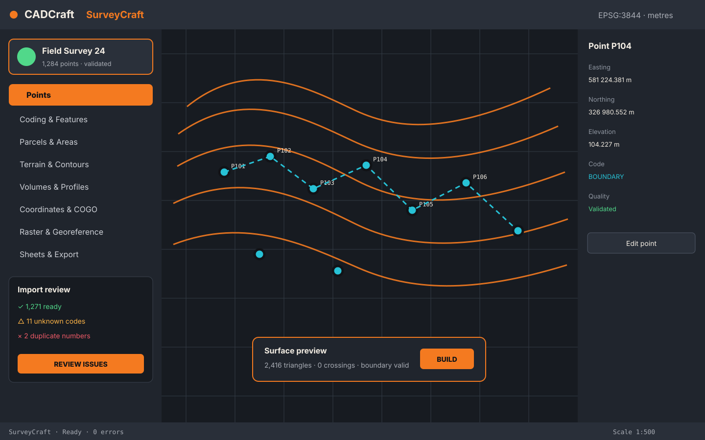

# SurveyCraft interface blueprint



## Visual language

SurveyCraft belongs inside CADCraft, so it inherits CADCraft's theme, typography, spacing, focus,
menus, dialogs and accessibility behavior. Orange identifies SurveyCraft-specific actions and
objects; it does not repaint the whole host application.

| Token | Value | Use |
|---|---|---|
| `survey-orange` | `#F47A20` | Brand mark, primary active state, selected survey features |
| `survey-orange-strong` | `#D85D0B` | Hover/pressed borders on light backgrounds |
| `survey-amber` | `#FFB547` | Warnings, unresolved point/code state |
| `survey-cyan` | `#27C2D6` | Instrument/target accent and secondary geometry |
| `survey-cream` | `#F4EEE4` | Icon foreground on dark/orange surfaces |
| `survey-ink` | `#111317` | Text/strokes on orange and light surfaces |
| `survey-success` | `#51D88A` | Validated/import-ready state |
| `survey-danger` | `#F05A67` | Invalid geometry or destructive scope |

Dark ink is used on orange because it has stronger contrast than white. Color never carries state
alone: every state also has an icon, label or pattern.

## Primary surfaces

### SurveyCraft palette

A dockable palette is the daily home for the extension:

- project/CRS summary and units;
- module switcher;
- selection-aware inspector;
- current operation progress/cancel;
- diagnostics count and quick fixes.

It should open at 300–360 logical pixels and collapse cleanly to a narrow icon rail. The drawing
canvas always remains visible.

### Point Manager

A native, virtualized table for up to 2,000 linked points is implemented in v0.3.0. It shows point
number, CAD X/Easting, CAD Y/Northing, elevation, code, description, quality and link status.
Filtering, drawing selection/location, staged editing, synchronization/repair, batch renumbering,
linked deletion and deterministic CSV export are available. Each write action commits in one
undoable transaction. See [POINT_MANAGER.md](POINT_MANAGER.md).

### Point import dialog (implemented MVP)

The first working task surface is a compact native CADCraft table. Press **Import and insert
points...** in the orange-marked **SurveyCraft** group at the top of CADCraft's Drafting Tool Sets,
open **SurveyCraft > Points > Import and insert points...**, or type `SCPOINTS`. It uses the orange
brand accent while keeping CADCraft's theme and controls. A user can:

- select CAD/GIS or Survey/TopoLT X/Y interpretation before insertion;
- type point number, source X, source Y, elevation (Z), and optional code/description;
- open UTF-8 CSV, COO, TXT or XYZ text, with comma, semicolon or tab delimiters;
- map common English and Romanian headers, or use the declared column order when no header exists;
- add rows, remove selected rows, sort by point number and clear the table;
- see missing, non-numeric and duplicate point-number errors before insertion;
- insert all valid rows as one drawing transaction and one Undo step.

This focused dialog remains the entry workflow. The v0.3 Point Manager uses the persistent point
identity created here for filtering, editing, repair and round-trip synchronization. Style controls
remain planned for a later version.

### Code-book editor (implemented in v0.4)

The v0.4 native manager presents one bounded rule table with add, edit, delete and JSON export.
`Preview changes` evaluates every unsaved row against coded points and refreshes the read-only
Preview column plus structured diagnostics without clearing edits. `Save changes` is rejected while
any bounded field is invalid, rule IDs conflict, or a rule references an unknown layer/symbol.
Layers remain embedded in the code-book model; a dedicated visual layer/symbol pane is later work.
Merely opening or previewing a book never mutates the drawing.

### Task dialogs

Import, parcel split, terrain build, contour and volume workflows use a consistent three-region
layout:

```text
+--------------------------------------------------------------+
| Task title                                      Help / Close |
+---------------------+----------------------------------------+
| inputs/settings     | live preview / summary                 |
|                     |                                        |
| validation messages | exact affected counts and tolerances   |
+---------------------+----------------------------------------+
| Back              Cancel                    Apply / Continue |
+--------------------------------------------------------------+
```

No irreversible work occurs when a file is merely selected or a preview is shown.

### In-canvas feedback

- Orange numbered badges show imported or selected survey points.
- Cyan lines show temporary observations, baselines and preview geometry.
- Orange/amber hatching distinguishes cut and fill without relying on color alone.
- A small heads-up card shows target area, current area and residual during parcel division.
- Long surface operations show progress and remain cancellable.

## Navigation

The top-level `SurveyCraft` menu mirrors the modules in the palette. Frequently used commands also
appear in SurveyCraft's orange-marked native Tool Sets group and CADCraft command search. The
extension does not create a second ribbon or private menu framework.

## Accessibility and localization

- Full keyboard traversal and visible focus.
- Screen-reader names use action + object, for example “Import survey points”.
- Numeric fields expose unit suffixes and never depend on placeholder text as their label.
- Dialogs remain usable at 1280×720 and 200% scaling.
- Every source string has a stable message ID; English is the initial catalog.
- Decimal display follows locale, while project/CSV formats remain explicit and unambiguous.

## Logo use

- `surveycraft-mark.svg`: repository avatar, extension tile and small app identity.
- `surveycraft-lockup.svg`: README, website and installer/catalog header.
- Do not place text inside the square mark.
- Keep clear space equal to one lens radius around the mark.
- At 24 px, omit background contour detail and retain the instrument silhouette and cyan lens.
